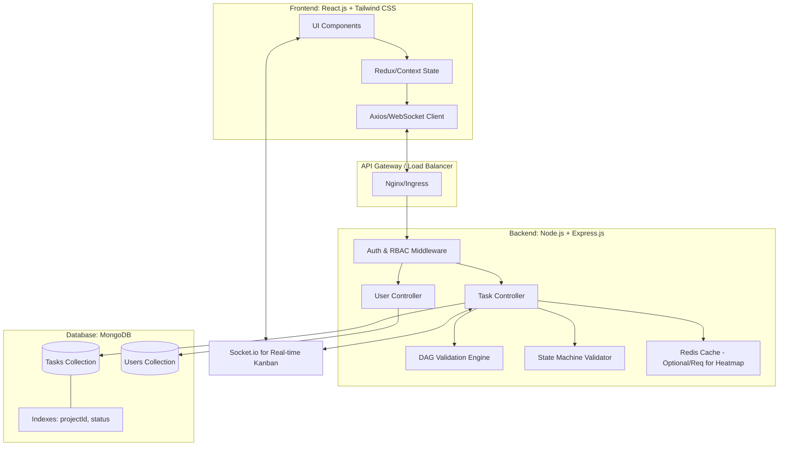

# High-Level Architecture (HLA): Enterprise Task Management System (TMS)

## 1. System Overview
The Enterprise Task Management System (TMS) is a professional-grade project orchestration platform. It employs a **MERN stack** (MongoDB, Express, React, Node) to handle complex task lifecycles, rigid role-based access control (RBAC), and a Directed Acyclic Graph (DAG) for dependency management.

### 1.1 Component Interaction Diagram


---

## 2. Frontend Architecture (React.js & Tailwind CSS)

### 2.1 Design Philosophy
*   **Atomic Design:** Components split into Atoms (Buttons, Inputs), Molecules (TaskCard), and Organisms (KanbanBoard).
*   **State Management:** Use of React Context for Auth and Redux Toolkit for the global Task state to ensure "Optimistic Updates" during Drag-and-Drop.
*   **Styling:** Utility-first approach via Tailwind CSS for high-performance rendering and responsive design.

### 2.2 Key Views
*   **Kanban Board:** A column-based view utilizing `react-beautiful-dnd` for task movement.
*   **User Management Panel:** Admin-only view for role assignments.
*   **Heatmap Dashboard:** Visual representation of task density using `Chart.js` or `Recharts`.
*   **Task Detail Modal:** Detailed view for mapping dependencies (Blocking/Blocked-by).

---

## 3. Backend Architecture (Node.js & Express.js)

### 3.1 Service Boundaries
*   **Auth Service:** Handles JWT issuance, password hashing (bcrypt), and session validation.
*   **RBAC Middleware:** Intercepts requests to verify if the user's role (`Admin`, `Editor`, `Viewer`) permits the action.
*   **Task Engine:** Manages CRUD operations and implements the **State Machine** (validating transitions like `To-Do` $\rightarrow$ `In Progress`).
*   **Dependency Engine:** Implements DFS (Depth First Search) algorithms to detect circular dependencies before persisting links.

### 3.2 State Machine Logic
The backend enforces a strict transition map:
*   `To-Do` $\rightarrow$ `In Progress` (Allowed if no dependencies are blocking)
*   `In Progress` $\rightarrow$ `Review`
*   `Review` $\rightarrow$ `Done`
*   *Illegal:* `To-Do` $\rightarrow$ `Done` (Blocked by API)

---

## 4. Data Models (MongoDB)

### 4.1 User Schema
```javascript
{
  _id: ObjectId,
  username: { type: String, unique: true, required: true },
  password: { type: String, required: true }, // Hashed
  role: { type: String, enum: ['Admin', 'Editor', 'Viewer'], default: 'Viewer' },
  email: { type: String, required: true }
}
```

### 4.2 Task Schema
```javascript
{
  _id: ObjectId,
  title: { type: String, required: true },
  description: String,
  status: { type: String, enum: ['To-Do', 'In Progress', 'Review', 'Done'], index: true },
  priority: { type: String, enum: ['Low', 'Medium', 'High', 'Critical'] },
  assignee: { type: ObjectId, ref: 'User', index: true },
  projectId: { type: ObjectId, index: true },
  dependencies: [{ type: ObjectId, ref: 'Task' }], // Tasks that MUST be 'Done' first
  version: { type: Number, default: 0 }, // For Optimistic Locking
  createdAt: Date,
  updatedAt: Date
}
```

---

## 5. API Contracts

### 5.1 Authentication & IAM
| Endpoint | Method | Role | Description | Payload | Response |
| :--- | :--- | :--- | :--- | :--- | :--- |
| `/api/auth/login` | POST | All | Authenticate user | `{user, pass}` | `{token, user}` |
| `/api/users/:id/role`| PATCH | Admin | Update user role | `{role}` | `{updatedUser}` |

### 5.2 Task Management
| Endpoint | Method | Role | Description | Payload | Response |
| :--- | :--- | :--- | :--- | :--- | :--- |
| `/api/tasks` | POST | Editor+ | Create task | `{title, desc, ...}` | `TaskObject` |
| `/api/tasks/:id` | PATCH | Editor+ | Update status/data | `{status, ...}` | `TaskObject` |
| `/api/tasks/:id/dep` | POST | Editor+ | Add dependency | `{dependsOnId}` | `TaskObject` |
| `/api/tasks/stats` | GET | All | Heatmap data | N/A | `{status: count}` |

### 5.3 Error Codes
*   `403 Forbidden`: RBAC failure (e.g., Viewer attempting to edit).
*   `409 Conflict`: Circular Dependency detected or Optimistic Locking version mismatch.
*   `422 Unprocessable Entity`: State machine violation (e.g., skipping Review).

---

## 6. Data Flow (Critical Paths)

### 6.1 Dependency Update Flow (Preventing Cycles)
1. **Request:** PM requests `Task B` to depend on `Task A`.
2. **Validation:** Backend triggers `DependencyEngine`.
3. **Algorithm:** Perform a Recursive DFS starting from `Task A`. If `Task B` is encountered in the traversal, a cycle exists.
4. **Outcome:** If cycle found $\rightarrow$ return `409 Conflict`. Else $\rightarrow$ persist to MongoDB.

### 6.2 Real-time Kanban Flow
1. **Action:** Developer drags card to `Review`.
2. **Client:** Sends `PATCH /api/tasks/:id` and optimistically updates UI.
3. **Server:** Validates state transition $\rightarrow$ Updates DB $\rightarrow$ Emits `task_updated` via **Socket.io**.
4. **Sync:** All other connected clients receive event and shift the card on their screens.

---

## 7. Docker Deployment Boundaries

### 7.1 Container Strategy
We utilize a multi-container architecture orchestrated via `docker-compose` (development) and K8s (production).

*   **`frontend-container`**: Nginx serving the production build of the React app.
*   **`backend-container`**: Node.js runtime executing the Express app.
*   **`mongodb-container`**: MongoDB 6.0+ with persistent volume mounts.
*   **`redis-container`**: Cache for heatmap aggregation and session management.

### 7.2 Docker Compose Structure
```yaml
services:
  frontend:
    build: ./frontend
    ports: ["80:80"]
    depends_on: [backend]
  backend:
    build: ./backend
    ports: ["5000:5000"]
    environment:
      - MONGO_URI=mongodb://mongo:27017/tms
      - REDIS_URL=redis://redis:6379
    depends_on: [mongo, redis]
  mongo:
    image: mongo:latest
    volumes: ["mongo-data:/data/db"]
  redis:
    image: redis:alpine
volumes:
  mongo-data:
```

---

## 8. Non-Functional Requirements (NFRs)

### 8.1 Scalability & Performance
*   **Database Indexing:** Compound indexes on `(projectId, status)` to ensure Kanban loads in $O(1)$ or $O(\log n)$ rather than $O(n)$.
*   **Caching:** Dashboard aggregation (Heatmap) is cached in Redis with a 5-minute TTL to prevent expensive MongoDB `$group` operations on 10k+ records.
*   **Latency:** API response target $< 200ms$ for standard CRUD.

### 8.2 Security
*   **JWT:** Stateless authentication using `HttpOnly` cookies to prevent XSS.
*   **Input Validation:** `express-validator` to sanitize all inputs and prevent NoSQL injection.
*   **RBAC:** Middleware-level role checks applied to every sensitive route.

### 8.3 Reliability
*   **Optimistic Locking:** The `version` field in the Task schema prevents "Lost Updates" by checking `where version = current_version` during updates.
*   **Orchestration:** K8s Liveness and Readiness probes ensure the Node.js pod is restarted if the event loop freezes.