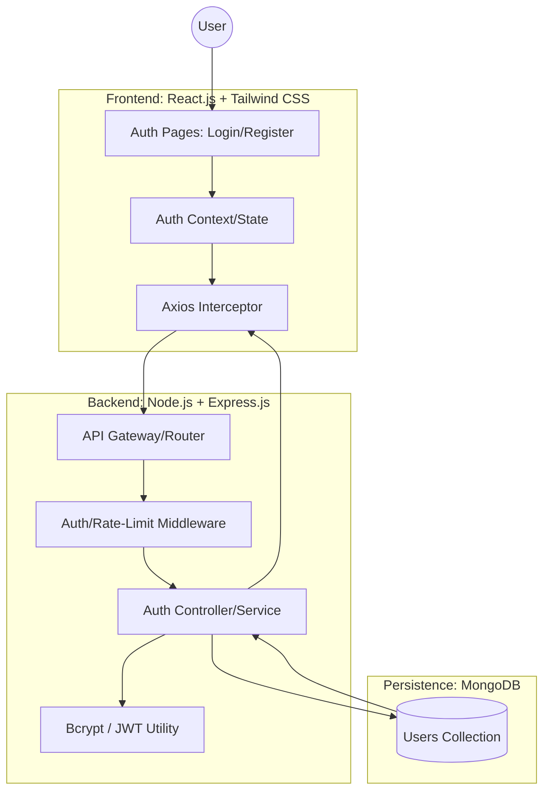

# High-Level Architecture (HLA): Secure Authentication Module

**Project Reference:** Secure Authentication Module (MERN Stack)  
**Architect:** Solution Architect  
**Status:** Final Design  

---

## 1. System Architecture Overview
The system follows a decoupled Client-Server architecture. The frontend is a Single Page Application (SPA) built with React.js and Tailwind CSS, communicating via a RESTful API with a Node.js/Express.js backend. Persistence is handled by MongoDB.

### 1.1 Component Interaction Diagram


---

## 2. Frontend Design (React.js & Tailwind CSS)

### 2.1 Component Structure
- **`AuthLayout`**: Wrapper providing consistent styling and centering for auth forms.
- **`RegistrationForm`**: 
    - State-driven validation (regex for email, length/special char for password).
    - Comparison logic for `password` vs `confirmPassword`.
    - Submit button `loading` state to prevent duplicate POSTs.
- **`LoginForm`**: 
    - Email/Password inputs.
    - Error handling for generic "Invalid email or password" messages.
- **`AuthProvider` (Context API)**: 
    - Manages the `accessToken` in memory.
    - Handles the `refresh` logic on application mount.

### 2.2 Styling Strategy
- **Framework**: Tailwind CSS.
- **UI Pattern**: Responsive centering using `flex items-center justify-center min-h-screen`.
- **Validation UI**: Red border-rings on input fields with absolute positioned error text for real-time feedback.

---

## 3. Backend Design (Node.js & Express.js)

### 3.1 Service Boundaries
- **Route Layer**: Defines API endpoints and maps them to controllers.
- **Middleware Layer**: 
    - `rateLimiter`: Prevents brute force (max 5 attempts/15 mins).
    - `validateSchema`: Uses Joi/Zod to ensure payloads match the contract.
    - `authenticateJWT`: Validates the Access Token for protected routes.
- **Controller Layer**: Orchestrates the business logic (e.g., "Check if user exists $\rightarrow$ Hash Pwd $\rightarrow$ Save").
- **Data Access Layer (Mongoose)**: Handles MongoDB queries and schema enforcement.

### 3.2 Security Implementation
- **Password Hashing**: `bcryptjs` with a salt round of 12.
- **Token Strategy**: 
    - **Access Token**: Short-lived (15m), sent in JSON response, stored in JS memory.
    - **Refresh Token**: Long-lived (7d), stored in `httpOnly`, `Secure`, `SameSite=Strict` cookie.
- **Case Sensitivity**: All emails converted to `.toLowerCase()` before database entry and lookup.

---

## 4. MongoDB Data Model

### 4.1 User Schema
**Collection:** `users`

| Field | Type | Constraints | Description |
| :--- | :--- | :--- | :--- |
| `_id` | ObjectId | Primary Key | Unique Identifier |
| `email` | String | Unique, Indexed, Required | User's unique email (lowercase) |
| `password` | String | Required | Bcrypt hashed password |
| `loginAttempts` | Number | Default: 0 | Track failed attempts for lockout |
| `lockUntil` | Date | Optional | Timestamp when account unlocks |
| `createdAt` | Date | Default: Date.now | Audit trail |
| `updatedAt` | Date | Default: Date.now | Audit trail |

---

## 5. API Contracts

### 5.1 Registration
`POST /api/auth/register`
- **Request Body**:
  ```json
  {
    "email": "user@example.com",
    "password": "Password123!",
    "confirmPassword": "Password123!"
  }
  ```
- **Success Response (201 Created)**:
  ```json
  { "message": "Registration successful", "userId": "..." }
  ```
- **Error Responses**:
    - `400 Bad Request`: Validation failure (password mismatch/weak password).
    - `409 Conflict`: Email already exists.

### 5.2 Login
`POST /api/auth/login`
- **Request Body**:
  ```json
  { "email": "user@example.com", "password": "Password123!" }
  ```
- **Success Response (200 OK)**:
  - **Body**: `{ "accessToken": "eyJ...", "user": { "email": "..." } }`
  - **Cookie**: `Set-Cookie: refreshToken=...; HttpOnly; Secure; SameSite=Strict`
- **Error Responses**:
    - `401 Unauthorized`: Invalid credentials.
    - `423 Locked`: Account locked due to brute force.

### 5.3 Token Refresh
`POST /api/auth/refresh`
- **Request**: No body; sends `refreshToken` cookie.
- **Success Response (200 OK)**:
  - **Body**: `{ "accessToken": "new_eyJ..." }`
- **Error Response**:
    - `401 Unauthorized`: Refresh token expired or invalid.

### 5.4 Logout
`POST /api/auth/logout`
- **Success Response (200 OK)**:
  - **Cookie**: `Set-Cookie: refreshToken=; Max-Age=0`

---

## 6. Data Flow

1. **Registration Flow**: `Frontend (Validation)` $\rightarrow$ `POST /register` $\rightarrow$ `Middleware (Schema Check)` $\rightarrow$ `Service (Bcrypt Hash)` $\rightarrow$ `MongoDB (Save)` $\rightarrow$ `Frontend (Redirect)`.
2. **Login Flow**: `Frontend` $\rightarrow$ `POST /login` $\rightarrow$ `Middleware (Rate Limit)` $\rightarrow$ `Service (Compare Hash)` $\rightarrow$ `JWT Utility (Issue Pair)` $\rightarrow$ `Response (JSON + Cookie)`.
3. **Persistence Flow**: `Frontend (App Mount)` $\rightarrow$ `POST /refresh` $\rightarrow$ `Backend (Verify Cookie)` $\rightarrow$ `Response (New Access Token)`.

---

## 7. Docker Deployment Boundaries

### 7.1 Container Strategy
- **`frontend-container`**: 
    - Build: Node.js image $\rightarrow$ `npm run build` $\rightarrow$ Nginx (to serve static files).
    - Port: 80.
- **`backend-container`**: 
    - Build: Node.js Alpine image.
    - Port: 5000.
    - Env Vars: `MONGO_URI`, `JWT_SECRET`, `REFRESH_SECRET`, `PORT`.
- **`mongodb-container`**: 
    - Image: `mongo:latest`.
    - Volume: `/data/db` (Persistent volume for data).
    - Port: 27017.

### 7.2 Network Topology
- Internal Docker Bridge Network.
- **Backend** connects to **MongoDB** via `mongodb://mongodb:27017/auth_db`.
- **Frontend** communicates with **Backend** via an Nginx reverse proxy or direct API URL.

---

## 8. Non-Functional Requirements (NFRs)

| Category | Requirement | Implementation |
| :--- | :--- | :--- |
| **Scalability** | Stateless Backend | JWTs ensure the backend doesn't store session state; easily scale horizontally with a Load Balancer. |
| **Security** | Defense in Depth | `httpOnly` cookies prevent XSS token theft; Bcrypt prevents rainbow table attacks; Rate limiting prevents brute force. |
| **Latency** | Response Time | MongoDB indexing on `email` ensures $O(1)$ lookup time for authentication. |
| **Reliability** | Persistence | Docker volumes ensure database state persists across container restarts. |